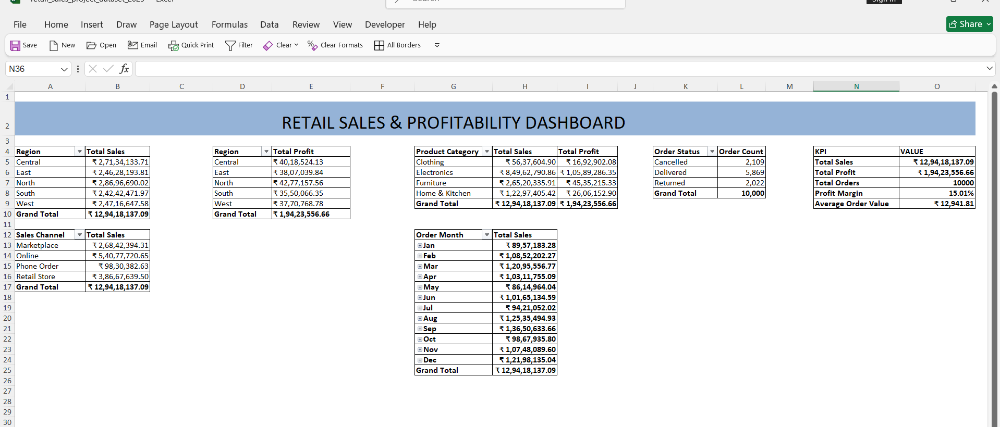

# Retail Sales & Profitability Analysis (2025)

An end-to-end retail sales analytics project using Microsoft Excel, Power Query, PivotTables and interactive dashboards to explore sales performance, profitability and business trends.

## 1. Project Overview

This project analyses a simulated Indian retail dataset covering January–December 2025. The objective is to transform raw transaction data into meaningful business insights through data cleaning, analysis and visualisation.

The project follows a practical analytics workflow, from raw data preparation to dashboard reporting and business recommendations.

**Dataset:** 10,000 retail transactions  
**Period:** January–December 2025  
**Data type:** Synthetic practice dataset

## 2. Business Objectives

- Analyse overall sales and profitability.
- Compare sales performance across regions and cities.
- Evaluate product category and product-level performance.
- Compare sales channels.
- Examine order status and payment methods.
- Identify data quality issues that may affect reporting.
- Present findings through an interactive Excel dashboard.

## 3. Tools & Skills

| Tool | Application |
|---|---|
| Microsoft Excel | Data analysis and reporting |
| Power Query | Data cleaning and transformation |
| PivotTables | Business performance analysis |
| PivotCharts | Data visualisation |
| Excel Dashboard | Interactive reporting |

## 4. Dataset Description

The dataset contains 19 fields, including:

- Order and customer information
- Customer segments
- Region and city
- Sales channel
- Product and category
- Quantity and unit price
- Discount amount and percentage
- Net sales, cost and profit
- Order status and payment method

## 5. Data Cleaning & Preparation

Power Query was used to prepare the dataset for analysis.

Key activities included:

- Standardising inconsistent text values in Region, Sales_Channel and Order_Status.
- Identifying and removing duplicate records.
- Reviewing missing values across relevant columns.
- Investigating invalid discount percentages.
- Checking unusual quantity values.
- Validating date formats and data types.
- Maintaining an audit trail of data quality issues and cleaning decisions.

Records requiring further business validation were not automatically modified or deleted.

## 6. Dashboard Preview

### Retail Sales Dashboard

### PivotTable Analysis

## 7. Project Files

| File | Description |
|---|---|
| `Retail_Sales_Profitability_Analysis_2025.xlsx` | Excel analysis workbook and dashboard |
| `retail_sales_raw_2025.csv` | Raw transaction dataset |
| `retail_sales_data_dictionary.xlsx` | Dataset field definitions |
| `PROJECT_BRIEF_AND_ASSIGNMENT.txt` | Project brief and assignment |
| `01_Retail_Sales_Dashboard.png.png` | Dashboard screenshot |
| `02_Pivot_Analysis.png.png` | Pivot analysis screenshot |

## 8. Business Insights & Recommendations

The analysis is designed to help answer questions such as:

- Which regions contribute most to sales and profit?
- Which products and categories perform best?
- Which sales channels generate stronger results?
- Are discounts associated with changes in profitability?
- How do returned and cancelled orders affect reported performance?

Final recommendations should be based on the validated results in the workbook.

## 9. Learning Outcomes

Through this project, I practised:

- Preparing and cleaning structured datasets.
- Using Power Query for repeatable data transformations.
- Investigating data quality issues.
- Building PivotTables and PivotCharts.
- Designing an interactive Excel dashboard.
- Translating data into business-focused questions.

## 10. Project Disclaimer

This project uses a synthetic dataset created for learning and portfolio demonstration. It does not represent the actual financial performance of a real company.

---

**Created by:** Priyanka Debnath  
**Project:** Retail Sales & Profitability Analysis  
**Year:** 2025
