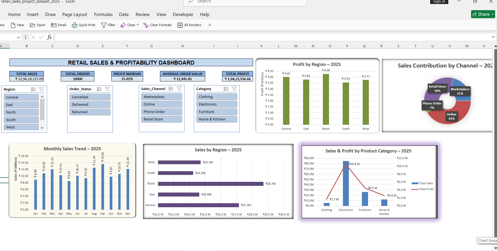

# Retail Sales & Profitability Analysis (2025)

An end-to-end retail sales analytics project using Microsoft Excel, Power Query, PivotTables and interactive dashboards to explore sales performance, profitability and business trends.

## 1. Project Overview

This project analyses a simulated Indian retail dataset covering January–December 2025. The objective is to transform raw transaction data into meaningful business insights through data cleaning, analysis and visualisation.

The project follows a practical analytics workflow, from raw data preparation to dashboard reporting and business recommendations.

**Dataset:** 10,000 retail transactions  
**Period:** January–December 2025  
**Data type:** Synthetic practice dataset

## 2. Business Objectives

- Analyse overall sales and profitability.
- Compare sales performance across regions and cities.
- Evaluate product category and product-level performance.
- Compare sales channels.
- Examine order status and payment methods.
- Identify data quality issues that may affect reporting.
- Present findings through an interactive Excel dashboard.

## 3. Tools & Skills

| Tool | Application |
|---|---|
| Microsoft Excel | Data analysis and reporting |
| Power Query | Data cleaning and transformation |
| PivotTables | Business performance analysis |
| PivotCharts | Data visualisation |
| Excel Dashboard | Interactive reporting |

## 4. Dataset Description

The dataset contains 19 fields, including:

- Order and customer information
- Customer segments
- Region and city
- Sales channel
- Product and category
- Quantity and unit price
- Discount amount and percentage
- Net sales, cost and profit
- Order status and payment method

## 5. Data Cleaning & Preparation

Power Query was used to prepare the dataset for analysis.

Key activities included:

- Standardising inconsistent text values in Region, Sales_Channel and Order_Status.
- Identifying and removing duplicate records.
- Reviewing missing values across relevant columns.
- Investigating invalid discount percentages.
- Checking unusual quantity values.
- Validating date formats and data types.
- Maintaining an audit trail of data quality issues and cleaning decisions.

Records requiring further business validation were not automatically modified or deleted.

## 6. Dashboard Preview

### Retail Sales Dashboard

### PivotTable Analysis

## 7. Project Files

| File | Description |
|---|---|
| `Retail_Sales_Profitability_Analysis_2025.xlsx` | Excel analysis workbook and dashboard |
| `retail_sales_raw_2025.csv` | Raw transaction dataset |
| `retail_sales_data_dictionary.xlsx` | Dataset field definitions |
| `PROJECT_BRIEF_AND_ASSIGNMENT.txt` | Project brief and assignment |
| `01_Retail_Sales_Dashboard.png.png` | Dashboard screenshot |
| `02_Pivot_Analysis.png.png` | Pivot analysis screenshot |

## 8. Business Insights & Recommendations

The analysis of 10,000 simulated retail transactions for 2025 revealed the following findings:

### Key Performance Indicators

| KPI | Result |
|---|---:|
| Total Net Sales | ₹12,94,18,137.09 |
| Total Profit | ₹1,94,23,556.66 |
| Profit Margin | 15.01% |
| Total Transactions | 10,000 |
| Average Order Value | ₹12,941.81 |

### Key Business Insights

**1. Regional Performance**
- North recorded the highest net sales at ₹2.87 crore and the highest profit at ₹42.77 lakh.
- Central ranked second in net sales at ₹2.71 crore.
- South recorded the lowest regional net sales at ₹2.42 crore.

**2. Sales Channel Performance**
- Online was the leading sales channel, contributing 41.79% of total net sales.
- Retail Stores contributed 29.88%, followed by Marketplace at 20.74%.
- Phone Orders contributed 7.60%.

**3. Product Category Performance**
- Electronics generated 65.65% of total net sales, making it the largest category.
- Furniture contributed 20.49% of net sales.
- Clothing recorded the highest category profit margin at 30.03%, while Electronics recorded the lowest at 12.46%.

**4. Monthly Sales Trend**
- September recorded the highest monthly net sales at approximately ₹1.37 crore.
- January recorded the lowest monthly net sales at approximately ₹89.57 lakh.

**5. Order Status Analysis**
- Delivered transactions: 5,869
- Returned transactions: 2,022
- Cancelled transactions: 2,109

Returned and cancelled transactions require separate monitoring because they affect reported sales and operational performance differently.

### Business Recommendations

- Review regional strategies in South to identify opportunities to improve sales performance.
- Strengthen the online channel while monitoring profitability and operating costs.
- Investigate the cost structure and pricing strategy of Electronics to improve its profit margin.
- Explore opportunities to expand Clothing sales while monitoring its current profitability.
- Investigate the reasons behind returned and cancelled transactions to identify potential improvements in fulfilment and customer experience.

*Note: These findings are based on a synthetic practice dataset and are intended for portfolio demonstration, not as actual business performance claims.*
## 9. Learning Outcomes

Through this project, I practised:

- Preparing and cleaning structured datasets.
- Using Power Query for repeatable data transformations.
- Investigating data quality issues.
- Building PivotTables and PivotCharts.
- Designing an interactive Excel dashboard.
- Translating data into business-focused questions.

## 10. Project Disclaimer

This project uses a synthetic dataset created for learning and portfolio demonstration. It does not represent the actual financial performance of a real company.

---

**Created by:** Priyanka Debnath  
**Project:** Retail Sales & Profitability Analysis  
**Year:** 2025
